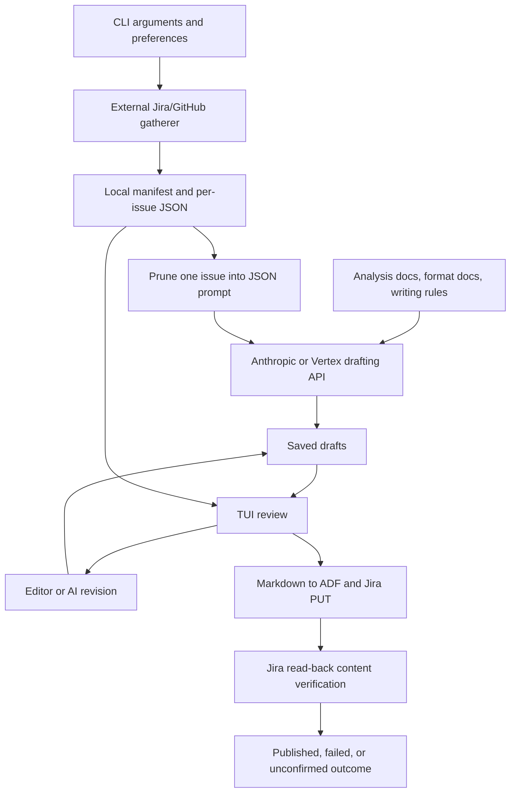

# End-to-end data flows

## Pipeline

Source entry points are [`cli.py`](../src/herald/cli.py),
[`StatusUpdateApp._run_pipeline`](../src/herald/app.py), and
[`gather.py`](../src/herald/gather.py). The diagram shows conceptual data
dependencies; the pipeline currently completes batch drafting before review.

## Configuration and gathering boundary

`load_prefs` reads the requested TOML file or the XDG configuration location.
Named profile values fill unset CLI arguments. `find_scripts_dir` resolves the
external status-analysis directory and its `scripts` child.

`run_gather` runs `gather_status_data.py` using Herald's Python interpreter.
The forwarded parameters are project, output directory, verbose mode, optional
custom JQL, optional component and label, repeated assignees/excluded
assignees, lookback days, optional start/end dates, and optional individual
issue keys. The exclude flag is translated to `--exclude-assignee`.

`--jql` is forwarded verbatim to the gatherer, where it replaces the entire
built-in root-issue query — including the `status != Closed` and
`status != "Release Pending"` guards. A profile that sets `jql` therefore owns
its own status filtering, and its `project`, `component`, `label`, `assignee`,
and `exclude` values have no effect on root selection. Explicit `--issue` keys
still take precedence over `--jql`. Either `project` or `jql` must be supplied.

The subprocess inherits the environment, including source credentials. The
exact upstream API queries, pagination, PR matching, and descendant traversal
are owned by the configured external script, not specified by Herald's code.
The wrapper does not explicitly forward `prefs.jira_url` to that script, so
gathering and publishing destination alignment is an external configuration
concern.

Herald consumes JSON manifest output from stdout and streams stderr to the
pipeline log. A nonzero exit becomes a gather failure. It expects
`manifest.config.date_range.end` and `manifest.issues` with issue keys; it
constructs the artifact directory as `<output-dir>/<end-date>`.

| Artifact | Writer | Consumers |
| --- | --- | --- |
| `<date-dir>/manifest.json` | External gatherer; Herald stamps `gathered_at` and per-issue capture times, then merges single-issue refresh manifests | Gather-cache loader, pipeline issue list, temporal prompt context |
| `<date-dir>/issues/<key>.json` | External gatherer | Draft pruning, previous-status display, refresh, optional coding agent |
| `<state-dir>/drafts/<output-dir-id>/<date>/drafts.json` | Herald | Batch reuse, review edits/revisions |
| `<state-dir>/drafts/<output-dir-id>/<date>/draft_inputs.json` | Herald | Confirms that a saved draft matches the exact current pruned evidence input |
| `<platform-cache>/herald/<cache-key>/cache_meta.json` | Herald | Gather-cache lookup; stores `date_dir` |
| Temporary draft/prompt Markdown files | Herald | External editor or coding agent; removed after handoff |

On Linux, `<state-dir>` is `$XDG_STATE_HOME/herald` or `~/.local/state/herald`.
Existing `<date-dir>/drafts.json` and `draft_inputs.json` files are read as a
legacy fallback; the next save writes them under `<state-dir>`.

For the temporal evidence contract, the manifest supplies `reporting_window`
with offset-aware `start`, `end_exclusive`, and IANA `timezone`. Its interval is
half-open. Date-only CLI bounds must be resolved by the external gatherer in
that timezone. Herald adds a UTC `gathered_at` timestamp after each fresh full
gather and records capture times in `issue_gathered_at`. A single-issue refresh
updates only that issue's time; untouched legacy issue data stays unknown.
Legacy/malformed window or timestamp metadata is represented to the model as
unknown. Issue files should provide dated `events_in_window`,
`carry_forward_context`, and explicit `undated_activity`; Herald checks event
timestamps against the manifest window. Legacy dated Jira comments and
transitions are adapted, while PR state and activity counts are not treated as
events. The external gatherer must provide individual dated merge, commit,
review, comment, and transition events.

The gathered issue files contain more context than the reduced drafting input.
The [initial drafting contract](initial-drafting.md) lists every forwarded
field. Previous status is loaded separately from each issue file's
`issue.current_status_summary`; it is a gather-time snapshot, not necessarily
the previous calendar week's report or a freshly re-read Jira value.

## Caching

There are two separate caches:

1. **Gather reuse:** a SHA-256-derived key covers project, component, label,
   sorted assignees/exclusions, days, and explicit start/end dates. Cache metadata
   must have been written on the current UTC day and point to an existing
   manifest. A hit skips the subprocess. `--refresh` bypasses this lookup.
2. **Draft reuse:** State `drafts.json` maps issue keys to text for each output
   directory and date. `draft_inputs.json` stores a SHA-256 fingerprint of the exact pruned JSON
   input. Herald reuses a draft only when that fingerprint matches; source,
   reporting-window, gather-time, or evidence changes trigger a new draft.
   `--redraft` bypasses draft reuse while leaving gather-cache reuse enabled.
   Existing drafts in the gathered-data directory are read as a migration
   fallback and copied into XDG state on the next save. The model and
   writing-rules configuration are not part of the fingerprint.

Gather cache identity omits Jira instance and output directory. Draft storage
is scoped by output directory and end date, not by filters or complete range;
input fingerprints prevent reuse when the resulting issue evidence differs.
Changing only the model or writing rules does not invalidate a draft. These
broader cache identity limitations remain tracked in
[issue #5](https://github.com/celebdor/herald/issues/5).

## Review and revision

Review initially receives manifest issues, draft strings, the reduced issue
summaries, and previous filed statuses. The table and stacked text panes show
draft and previous status. There is currently no Evidence pane or persistent
review-decision storage.

| Revision path | Inputs | Access / output |
| --- | --- | --- |
| `$EDITOR` | Current draft in a temporary Markdown file | User edits locally; resulting text replaces and saves the draft; comment lines beginning `#` are removed |
| API revision | Reduced issue summary, current draft, user's instruction | One or more Anthropic/Vertex calls (a truncated response is retried once with a doubled output limit) with the temporal evidence rules and formatting instruction; no tools or conversation history; output limit from `[llm].max_tokens` (default 8192) |
| Coding-agent revision | Summary, instruction, temporary draft path, gathered issue/data-directory paths when available | External CLI receives the temporal evidence rules, can read fuller gathered JSON and use tools such as `gh`; revised draft file is read back and saved |

API revisions do not reuse the initial analysis documents or writing-rules
system prompt, but they retain the temporal evidence rules and issue summary.
A configured coding agent is used only when its executable can
be resolved; otherwise revision falls back to the API path. Agent behavior
depends on its own environment/configuration and can access more than the
initial drafting API.

## Refresh

Single-issue refresh bypasses gather caching, asks the external script for that
issue, merges its manifest entries, reloads its issue JSON, prunes it, and makes
a new initial-style drafting call using the session's system prompt. It
replaces the working draft and summary and clears that issue's review result.

Refresh-all gathers the whole scope, deletes the saved draft cache before
batch drafting, and updates working drafts and summaries. At this baseline it
retains the existing review issue list and previous-status snapshots rather
than rebuilding them from the new manifest. Neither refresh path has draft
version history or protection for manual edits. See
[issue #4](https://github.com/celebdor/herald/issues/4).

## Jira publication

`a` starts publication and `p` retries a failed/unconfirmed publication.
[`update_jira_status`](../src/herald/jira.py) converts the draft Markdown to
ADF and PUTs `fields.customfield_10814` to
`<prefs.jira_url>/rest/api/3/issue/<key>`. A successful HTTP write is followed by
a GET for that field and normalized ADF comparison with the submitted value.
Normalization ignores `version` keys and mark ordering, but preserves content
array order.

- A matching read-back is **published** and counts under Updated.
- A rejected write is **failed** in the review flow.
- Transport uncertainty, failed read-back, absent field, or mismatched content
  is **unconfirmed** and does not count as published.

Duplicate writes for an issue are blocked while publishing, and already
published results cannot be published again through the same action. Quitting
review waits for its tracked publications before closing the HTTP session and
showing the summary. Outcomes and decisions remain in memory; they are not
restored on reopening ([issue #3](https://github.com/celebdor/herald/issues/3)).

The API write and read-back do not send further data to the drafting model.
The session's final summary also fetches model-pricing metadata separately to
estimate cost; that request does not include the issue payload.

## Planned contract changes

- [PR #8](https://github.com/celebdor/herald/pull/8): draft validation and
  separate quiet/missing-data/drafting-failure/invalid-output outcomes; the
  batch return tuple gains an outcomes mapping.
- [Issue #6](https://github.com/celebdor/herald/issues/6): a hidden-by-default,
  toggleable Evidence pane. Saved raw issue data must remain distinguishable
  from the narrower context actually supplied to a particular model call.
- [Issue #3](https://github.com/celebdor/herald/issues/3): durable session outcomes.
- [Issue #4](https://github.com/celebdor/herald/issues/4): recoverable draft history.
- [Issue #5](https://github.com/celebdor/herald/issues/5): reliable cache context/freshness.

Change these sections to implemented behavior when the corresponding code
lands, including any changed field mappings in the initial drafting contract.
